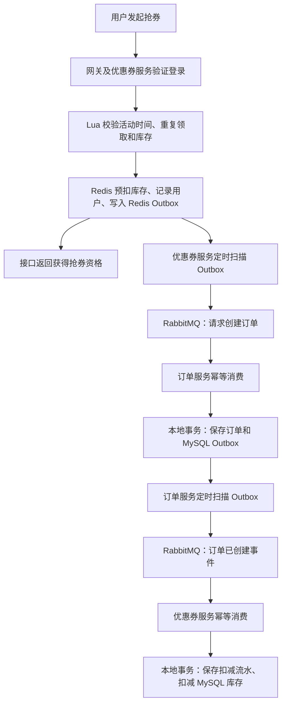

# M1kasa 秒杀下单与库存一致性方案

整理日期：2026-10-27。本文依据当前项目代码及当天的真实联调结果整理，供开发复习、排查问题和面试介绍使用。

## 1. 方案概览

当前采用 **Redis Lua 预扣库存 + Redis Outbox + RabbitMQ 异步创建订单 + MySQL Outbox + 库存幂等扣减**。

抢券接口负责快速判断用户是否获得资格；订单创建、优惠券数据库库存更新由后台消息链路继续处理。请求成功表示获得抢券资格，不能直接理解成订单已经创建或数据库库存已经同步。



这是一种异步最终一致性设计。Redis、订单库和优惠券库之间没有一个覆盖全部操作的全局事务；中间存在数据尚未同步的时间窗口。永久失败、消息进入死信后仍未处理等情况，需要补偿才能收敛，不能宣称当前已实现任何故障下都不丢消息或全链路强一致。

## 2. 两段消息分别做什么

| 项目 | 第一段：请求创建订单 | 第二段：通知订单已创建 |
| --- | --- | --- |
| 生产者 | 优惠券服务 | 订单服务 |
| 消费者 | 订单服务 | 优惠券服务 |
| 消息类型 | `SeckillOrderCreateMessage` | `SeckillOrderCreatedMessage` |
| 业务含义 | 请为获得资格的用户创建订单 | 订单已创建，请同步扣减数据库库存 |
| 交换机 | `m1kasa.seckill.exchange` | `m1kasa.order.exchange` |
| 路由键 | `seckill.order.create` | `seckill.order.created` |
| 业务队列 | `m1kasa.seckill.order.queue` | `m1kasa.voucher.stock.deduct.queue` |
| 待发送记录 | Redis Hash | 订单数据库中的 Outbox 表 |
| 发布成功后的处理 | 删除对应 Hash 字段 | 将该行 `status` 更新为 `1` |

两个消息体的字段分别是：

```java
// 获得抢券资格后发送，此时尚无订单 ID
SeckillOrderCreateMessage(requestId, voucherId, userId)

// 订单落库后发送，包含已生成的订单 ID
SeckillOrderCreatedMessage(requestId, orderId, voucherId, userId)
```

第二段处理的是 MySQL 库存。Redis 库存在抢券时已经预扣，两次操作分别更新不同存储中的库存数据。

## 3. 第一段：Redis 预扣与 Redis Outbox

### 3.1 为什么不能只写“扣 Redis，再发送 MQ”

如果两个操作由 Java 顺序调用，存在失败窗口：

```text
Redis 预扣成功
    → 进程在发送 MQ 前退出
    → 没有下单消息，也没有后台可以继续发送的记录
```

发布确认只能帮助判断已经发起的发送，无法恢复从未执行过的发送操作。

### 3.2 Lua 正常成功时，一起完成三个写入

| Redis Key 示例 | 类型 | 内容 |
| --- | --- | --- |
| `m1kasa:seckill:activity:{24}` | Hash | 库存、活动开始和结束时间 |
| `m1kasa:seckill:buyers:{24}` | Set | 已获得资格的用户 ID |
| `m1kasa:seckill:outbox:{24}` | Hash | `requestId → userId` |

脚本先校验活动、时间、用户是否重复领取、库存和相关数据，再执行：

```lua
redis.call('HINCRBY', activityKey, 'stock', -1)
redis.call('SADD', buyersKey, userId)
redis.call('HSET', outboxKey, requestId, userId)
return 0
```

例如用户 `2474` 抢券 `24`，请求 ID 为 `abc123`：

```text
Redis 库存：2 → 1
buyers 集合：加入 2474
Outbox：abc123 → 2474
```

优惠券 ID 位于 Key 中，所以后台可以从该 Hash 条目还原完整下单消息。

相同的 `{24}` 是 Redis Cluster 的 Hash Tag，为多 Key Lua 操作落在同一槽位提供条件；这不表示项目当前已经部署了 Redis Cluster。

**Lua 的原子执行不等于出错自动回滚，也不等于数据已经持久化。** 当前脚本预先检查了 Outbox 类型等条件，但不能由此推导出所有运行时错误都不可能发生。Redis 自身的持久化、复制、故障恢复和必要的对账仍需单独保障。

### 3.3 后台如何投递

`SeckillOutboxJob` 启动后延迟 5 秒执行；每轮方法结束后等待 2 秒再执行。它枚举数据库中的秒杀活动，包含已结束的活动，并通过 HSCAN 扫描 Redis Outbox。

`count(100)` 是 Redis 扫描数量提示，不是每次严格返回 100 条的承诺。

每条记录交给 `SeckillOutboxDispatcher`：

```text
读取原 requestId 和 userId
    → 构造 SeckillOrderCreateMessage
    → 调用 SeckillOrderPublisher.send()
    → 发布检查通过，HDEL 对应 requestId
    → 失败或超时，保留记录等待重试
```

只删除发布成功的 Hash 字段，不删除整个活动的 Outbox。活动数据在待发送记录排空前不能随意清理，否则当前按数据库枚举活动的任务可能无法再次发现积压记录。

删除 Redis Outbox 仅表示消息已通过发布检查，不代表订单已经创建。

## 4. 第二段：订单落库与 MySQL Outbox

### 4.1 为什么这次将 Outbox 放在 MySQL

订单保存在 MySQL。若待发送记录仍写 Redis，就变成跨两种存储的双写：

```text
MySQL 订单提交成功
    → 写 Redis Outbox 前进程退出
    → 订单存在，但没有库存同步事件可供重试
```

当前将待发送记录和订单放在同一数据库，通过同一个数据源和本地事务管理器一起提交。

```java
@Transactional
public Long create(SeckillOrderCreateMessage message) {
    // 保存订单，获取数据库生成的 orderId
    // 保存 tb_seckill_order_outbox，status=0
    // 两步在同一个本地事务中提交
    return orderId;
}
```

任意一步抛出需要回滚的异常，两步一起回滚。两张表均采用 InnoDB。

因此两处 Outbox 的选型原则一致：**将待发送记录与对应的业务写入放在能原子提交的位置。**

| 业务写入 | Outbox 位置 | 一起提交的机制 |
| --- | --- | --- |
| Redis 预扣库存 | Redis | Lua 正常执行成功 |
| MySQL 创建订单 | 同一个 MySQL 数据库 | 本地事务 |

### 4.2 订单 Outbox 表

表名：`tb_seckill_order_outbox`，位于订单数据库。

| 字段 | 含义 |
| --- | --- |
| `id` | 自增主键，供后台扫描使用 |
| `request_id` | 抢券业务请求 ID，唯一 |
| `order_id` | 已创建的订单 ID，唯一 |
| `voucher_id` | 优惠券 ID |
| `user_id` | 用户 ID |
| `status` | `0` 待发送，`1` 已通过发布检查 |
| `create_time`、`update_time` | 创建和更新时间 |

`status=1` 不是“数据库库存已扣减”的状态，也不是消费者处理成功回执。

### 4.3 后台发送逻辑

`SeckillOrderOutboxJob` 读取 `status=0` 的记录，按 ID 扫描，每批最多 100 条。扫描位置到末尾后归零，再扫描此前未成功发送的记录。

```text
读取待发送行
    → 构造 SeckillOrderCreatedMessage
    → publisher.send(message).join()
    → 发布检查成功，将该行 status 从 0 改为 1
    → 失败或超时，保留 status=0
```

如果 RabbitMQ 已收到消息，但更新状态失败，任务之后可能重发。消费幂等需要覆盖这种情况。

## 5. 三种 ID 的区别

假设一次成功获得资格的抢券请求，其业务请求 ID 为 `abc123`：

| 标识 | 示例 | 重发时是否改变 |
| --- | --- | --- |
| 消息体 `requestId` | `abc123` | 同一条业务记录重发时不变 |
| 第一段消息 `messageId` | `abc123` | 不变 |
| 第二段消息 `messageId` | `seckill-order-created:abc123` | 不变 |
| `CorrelationData.id` | 每次生成的 UUID | 每次发送尝试重新生成 |
| `orderId` | MySQL 生成的订单 ID | 订单创建后保持不变 |

`requestId` 标识抢券业务；`messageId` 是发送代码设置的 MQ 消息属性；`CorrelationData.id` 用来关联某一次发送的发布确认。

用户再次发起 HTTP 抢券请求时，Java 可能生成新的请求 ID；是否还能获得资格，由 Lua 的用户重复领取校验决定。后台重发已有 Outbox 时必须沿用记录中的原请求 ID。

**RabbitMQ 不会仅因为 `messageId` 相同就自动去重。** 当前消费幂等依靠数据库约束及业务内容核对。

## 6. 发布确认、消费确认和 join()

### 6.1 发布确认：生产者与 RabbitMQ 之间

生产者使用以下组合：

```yaml
spring:
  rabbitmq:
    publisher-confirm-type: correlated
    publisher-returns: true
    template:
      mandatory: true
```

发送时设置持久化消息，等待 `CorrelationData` 的 Future，并检查：

1. 是否收到无法路由的退回消息。
2. `confirm.ack()` 是否为真。
3. 是否发生发送异常或 5 秒确认超时。

`convertAndSend()` 返回本身不能证明消息已被 RabbitMQ 接收。无法路由的消息也可能获得发布 ACK，因此必须结合退回检查。持久化消息路由到持久化队列时，发布确认包含相应的持久化要求。[RabbitMQ 发布确认说明](https://www.rabbitmq.com/docs/confirms#publisher-confirms)

### 6.2 消费确认：消费者与 RabbitMQ 之间

当前使用 Spring AMQP 的 `acknowledge-mode: auto`。正常业务处理中，监听方法成功返回后，由监听容器确认消费；这不是 RabbitMQ 原生“收到即确认”的模式。

当前事务方法位于独立的 Writer Bean 中：

```text
监听器调用业务 Service
    → Service 调用事务 Writer
    → 数据库事务提交
    → 业务 Service 和监听方法正常返回
    → Spring 监听容器确认消费
```

消费者不能捕获所有异常后直接正常返回，否则失败业务可能被当作消费成功。

发布确认与消费确认互相独立，发布确认不等待订单或库存业务完成，也不能假定消费者一定在发布确认之后才开始处理。[RabbitMQ 两类确认的区别](https://www.rabbitmq.com/docs/confirms#are-publisher-confirms-related-to-consumer-delivery-acknowledgements)

### 6.3 join() 的实际作用

```java
publisher.send(message).join();
```

含义是：后台线程等待返回的 Future 成功或异常完成。

- 不主动向 RabbitMQ 发送 ACK。
- 不等待消费者业务处理完成。
- 不会让原来的抢券 HTTP 请求等待后台任务。
- 当前后台循环是逐条发送、逐条等待，没有实现批量并行投递。
- 超时表示结果未知；消息可能已经到达 RabbitMQ，重试可能产生重复。

可靠性由 Outbox、确认检查、重试、持久化和消费幂等共同提供，不能只归因于 `join()`。

## 7. 为什么必须做消费幂等

幂等要求：同一个业务消息处理多次，业务结果与成功处理一次相同。

常见重复场景：

```text
消费者提交数据库事务
    → 消费 ACK 发出前进程退出
    → RabbitMQ 未收到确认，重新投递
```

另一个场景是生产者发送成功，但没有及时收到发布确认，之后再次发送。

如果不做幂等，同一次抢券可能重复创建订单，同一个订单也可能重复扣减库存。

### 7.1 创建订单的幂等

订单表 `tb_voucher_order` 使用：

- `request_id` 唯一约束：同一个请求不重复创建订单。
- `(user_id, voucher_id)` 联合唯一约束：同一用户不能重复购买同一张券。

`SeckillOrderWriter` 负责事务写入；外层 `OrderServiceImpl` 在内部事务回滚后捕获重复键异常，查询已存在订单并核对业务内容。

只有能够证明是对应的已有订单，才能正常返回；不能将任意异常都吞掉。

### 7.2 扣库存的幂等

优惠券数据库中的 `tb_seckill_stock_deduction` 是针对秒杀扣库存的流水表，也作为消费幂等凭证。

| 字段 | 用途 |
| --- | --- |
| `order_id` | 主键，同一订单只允许一条扣减记录 |
| `request_id` | 唯一键，防止同一请求重复扣减 |
| `voucher_id`、`user_id` | 记录并核对业务内容 |
| `create_time` | 记录处理时间 |

`SeckillStockWriter.deduct()` 在一个本地事务中执行：

```text
先插入扣减流水
    → 再执行数据库库存减 1
    → 一起提交
```

库存更新 SQL：

```sql
UPDATE tb_seckill_voucher
SET stock = stock - 1,
    update_time = CURRENT_TIMESTAMP
WHERE voucher_id = #{voucherId}
  AND stock > 0;
```

影响行数不是 `1` 时抛异常，使前面的流水一起回滚。库存条件与扣减在同一条 SQL 中执行。

重复键异常由外层 `SeckillStockServiceImpl` 在事务回滚后处理：查询流水，核对 `orderId`、`requestId`、`voucherId`、`userId` 全部一致，才将其视为已处理成功。不存在记录或内容不一致，继续抛异常。

不能只做“先查流水，不存在再扣库存”；并发请求可能同时查不到。真正防止并发重复的关键是数据库唯一约束，以及流水和业务写入的同一事务。

## 8. 重试和死信队列

当前两个消费端采用类似配置：

```yaml
spring:
  rabbitmq:
    listener:
      type: simple
      simple:
        acknowledge-mode: auto
        default-requeue-rejected: false
        prefetch: 10
        retry:
          enabled: true
          max-retries: 2
          initial-interval: 1s
          multiplier: 2
          max-interval: 5s
```

当前 Spring Boot 配置中的 `max-retries: 2` 表示首次处理失败后最多重试两次。失败消息在重试耗尽后拒绝且不重新入原队列，在已声明的死信拓扑正常工作时转入死信队列。

`prefetch: 10` 限制未确认消息的预取数量，不代表 10 个消费线程或每秒处理 10 条。

| 业务 | 死信交换机 | 死信路由键 | 死信队列 |
| --- | --- | --- | --- |
| 创建订单 | `m1kasa.seckill.order.dlx` | `seckill.order.failed` | `m1kasa.seckill.order.dlq` |
| 扣减库存 | `m1kasa.voucher.stock.dlx` | `seckill.stock.deduct.failed` | `m1kasa.voucher.stock.dlq` |

死信队列只是失败消息的接收位置，当前没有实现完整的自动重放、人工处理和业务补偿流程。默认死信转发本身也存在投递失败的边界，不能认为配置了 DLX 就一定可以恢复所有失败。[RabbitMQ 死信转发安全说明](https://www.rabbitmq.com/docs/dlx#safety)

已修正库存队列曾引用错误死信交换机名称的问题，并在确认旧队列为空且无消费者后，重建了该业务队列。今后修改已声明队列的固定参数，应先核对消息和消费者状态，不能直接删除有消息的队列。

## 9. 故障场景与当前处理

| 故障点 | 当前处理或边界 |
| --- | --- |
| Redis 预扣成功，发送前优惠券进程退出 | Redis Outbox 保留时，恢复后继续扫描发送 |
| 发布未确认、退回或超时 | 保留待发送记录并重试；超时不能直接认定没收到 |
| 第一段发布成功，HDEL 之前退出 | 可能重发，订单唯一约束和幂等处理兜底 |
| 订单插入后，MySQL Outbox 插入失败 | 同一本地事务回滚，消息消费失败 |
| 订单事务提交后，消费 ACK 前退出 | 重新投递，订单幂等处理已有订单 |
| 第二段发布成功，更新 Outbox 状态前退出 | 可能重发，库存流水唯一约束兜底 |
| 流水插入成功，库存扣减失败 | 同一本地事务回滚，不保留成功流水 |
| 库存事务提交后，消费 ACK 前退出 | 重新投递，核对已有流水后正常返回 |
| Redis 数据本身丢失 | 依赖持久化、复制和恢复能力，当前未验证完整灾难恢复 |
| 消费持续失败进入死信队列 | 需要后续排查、重放或补偿，当前没有自动收敛保证 |

目前“减少发送环节的丢失窗口”和“业务最终一定完成”是两个不同层次。前者依靠已有 Outbox 等机制，后者还需要异常处理、告警和补偿。

## 10. 当前主要代码职责

| 模块 | 类或组件 | 职责 |
| --- | --- | --- |
| 优惠券服务 | `VoucherServiceImpl`、抢券 Lua | 资格判断、Redis 预扣及 Outbox 写入 |
| 优惠券服务 | `SeckillOutboxJob` | 扫描 Redis 待发送记录 |
| 优惠券服务 | `SeckillOutboxDispatcher` | 还原消息，发布成功后删除对应记录 |
| 优惠券服务 | `SeckillOrderPublisher` | 发送创建订单消息并检查发布结果 |
| 订单服务 | `SeckillOrderConsumer` | 接收创建订单请求 |
| 订单服务 | `OrderServiceImpl` | 消息校验及重复订单核对 |
| 订单服务 | `SeckillOrderWriter` | 本地事务保存订单及数据库 Outbox |
| 订单服务 | `SeckillOrderOutboxJob` | 扫描数据库待发送记录并更新状态 |
| 订单服务 | `SeckillOrderCreatedPublisher` | 发送订单已创建事件并检查发布结果 |
| 优惠券服务 | `SeckillStockConsumer` | 接收订单已创建事件 |
| 优惠券服务 | `SeckillStockServiceImpl` | 校验消息及核对重复扣减流水 |
| 优惠券服务 | `SeckillStockWriter` | 本地事务保存流水并扣减库存 |
| API 模块 | 两种消息 record | 定义服务之间的消息数据结构 |

事务 Writer 由另一个 Spring Bean 调用，以经过事务代理。外层的重复异常检查在内部事务结束后执行，避免把失败事务内的状态当成成功凭证。

## 11. 启动与接口

服务入口：网关 `8080`、用户 `8081`、店铺 `8082`、优惠券 `8083`、订单 `8084`。MySQL、Redis、RabbitMQ 也需要正常运行。

两处任务开关分别位于对应服务中：

```yaml
# 优惠券服务
m1kasa:
  seckill:
    outbox:
      enabled: true
```

```yaml
# 订单服务
m1kasa:
  order:
    outbox:
      enabled: true
```

两服务均需开启 Spring 定时任务。消费服务声明完成交换机、队列及绑定后，再开始首次投递。连接密码通过实际运行配置提供，本文不包含任何密码或登录 token。

| 接口 | 用途 |
| --- | --- |
| `POST /voucher/seckill` | 本地创建测试活动，优惠券服务需启用 `local` profile |
| `POST /voucher/seckill/{voucherId}/init` | 活动开始前初始化 Redis，本地接口 |
| `POST /voucher/seckill/{voucherId}/reserve` | 登录用户抢券 |
| `GET /order/of/voucher/{voucherId}` | 查询当前用户对应优惠券的订单，可供轮询 |
| `GET /order/of/me?current=1&size=10` | 当前用户订单分页列表 |
| `GET /order/{orderId}` | 当前用户订单详情 |

接口经过网关时使用 `Authorization: Bearer <token>`。订单查询从登录态取得用户 ID，并在查询条件中限制所属用户。

## 12. 2026-10-27 联调记录

以下是自动联调完成时的快照，不代表之后手动测试仍保持相同库存和记录数量。

| 项目 | 实测结果 |
| --- | --- |
| 新建隔离测试券 | 优惠券 `24`，初始库存 `2` |
| 测试用户 | 用户 `2474` |
| 抢券接口 | 返回成功 |
| 创建订单 | 订单 `3`，待支付状态 |
| MySQL 库存 | 从 `2` 变为 `1` |
| 订单 Outbox | 一条记录，最终 `status=1` |
| 扣减流水 | 一条，与订单和业务请求对应 |
| 再次投递相同订单已创建事件 | 消费确认完成，库存仍为 `1`，流水仍为一条 |
| 同一用户再次抢同一券 | 返回 `409` |
| 订单列表及详情 | 查询通过 |
| 库存消费者及死信绑定 | 拼写修复后消费者恢复，队列无积压，绑定核对通过 |

已核对订单表、Outbox 表和扣减流水表的相应唯一约束。此次是正常流程及重复事件联调，尚未执行进程宕机、断网、Redis 数据恢复或死信重放等故障注入验证。

手动验证时，应新建独立测试券、在开始前预热。重复测试不要直接重置已经开始活动的 Redis 库存；现有活动可能已结束，且原用户可能已经获得过资格。

查询优惠券数据库：

```sql
-- 将 24 替换为本轮测试券 ID
SELECT voucher_id, stock
FROM tb_seckill_voucher
WHERE voucher_id = 24;

SELECT order_id, request_id, voucher_id, user_id, create_time
FROM tb_seckill_stock_deduction
WHERE voucher_id = 24;
```

查询订单数据库：

```sql
SELECT id, request_id, user_id, voucher_id, status
FROM tb_voucher_order
WHERE voucher_id = 24;

SELECT id, request_id, order_id, voucher_id, status
FROM tb_seckill_order_outbox
WHERE voucher_id = 24;
```

验证库存幂等，应重复投递相同的库存事件，并核对库存和流水。再次点击抢券主要验证的是资格防重，不能代替库存消费者的重复事件测试。

## 13. 已完成与后续工作

### 已完成并核对代码或正常联调

- Redis 资格判断、预扣库存和 Redis Outbox。
- 两段 RabbitMQ 发布确认、退回检查及持久化消息。
- 订单与 MySQL Outbox 的本地事务。
- 订单创建的数据库唯一约束及重复业务核对。
- 库存流水与库存扣减的本地事务、重复消费核对。
- 消费重试配置和两组死信拓扑。
- 前端抢券、异步订单结果查询，以及订单列表、详情后端接口。

### 尚未完整实现或验证

- 死信消息的排查、受控重放、处理记录及告警。
- 最终下单失败后的资格释放和 Redis 库存回补；必须先核实订单及消息状态，不能仅因发送超时就回补。
- 订单、Redis 预占、数据库库存之间的对账及异常修复。
- 支付、取消、超时关闭和对应库存回补。当前下单扣减属于待支付订单占用库存，尚无完整释放流程。
- 老订单的库存同步和 Outbox 回填；新代码不会自动为历史订单生成事件。
- Outbox 任务的并发调度、吞吐优化、失败退避、积压监控和数据保留策略。
- Redis、MySQL、RabbitMQ 的故障恢复验证；不能根据业务代码推断部署已经具备持久化或高可用保障。

## 14. 面试时如何介绍

可以这样描述当前方案：

> 我将秒杀资格判断与订单落库拆成异步链路。抢券阶段使用 Redis Lua 完成库存预扣、用户防重和 Redis Outbox 写入，再由后台可靠投递下单消息。订单服务通过本地事务一起保存订单和 MySQL Outbox，随后发布订单已创建事件，由优惠券服务异步同步数据库库存。两段消费分别通过订单唯一约束、扣减流水唯一约束实现幂等；流水和库存扣减处于同一个事务。正常下单和重复库存事件已经联调通过，死信重放、最终失败后的库存回补及对账仍在完善。

介绍时应区分“有可靠投递机制”和“任何故障绝不丢”，“订单已创建”和“库存已同步”。本次联调没有产生可用于证明该微服务版本性能的压测数据。
